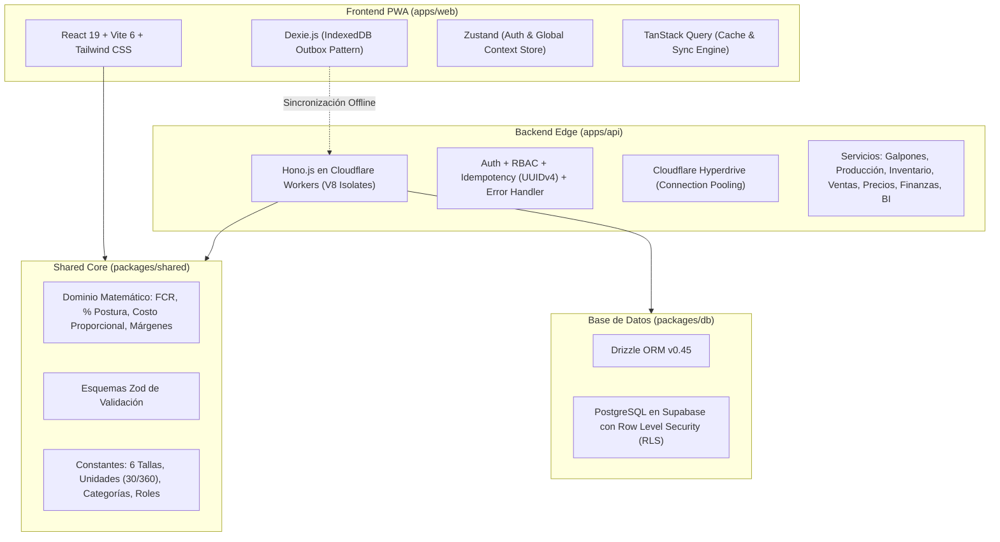
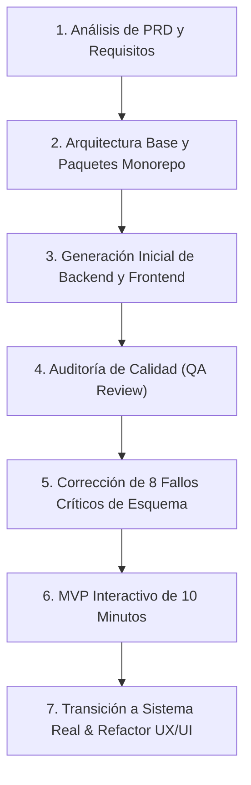

# 📘 Informe Integral: Arquitectura, Evolución Técnica y Diseño UX/UI
## ERP & Business Intelligence Agroindustrial "Alta La Estancia"

---

## 🏛️ 1. Arquitectura Técnica Global

El sistema se diseñó bajo los principios de **Clean Architecture**, **Domain-Driven Design (DDD)** y **Screaming Architecture**, estructurado en un **Monorepo gestionado por PNPM y Turborepo**:

### Componentes del Monorepo:
1. **`packages/shared`:** La verdad única del negocio. Contiene lógica pura sin dependencias de base de datos ni frameworks.
   - Constantes de las 6 tallas de huevo (`P`, `CH`, `M`, `G`, `XG`, `XXG`) con gramajes exactos.
   - Factores de negocio: 1 Maple = 30 unidades, 1 Caja Estándar = 12 maples = 360 unidades.
   - Fórmulas de postura y FCR.
   - Validaciones de entrada mediante Zod.
2. **`packages/db`:** Esquemas relacionales en Drizzle ORM para PostgreSQL (Supabase).
   - Tablas maestras: `usuarios`, `galpones`, `lotes_aves`, `tallas_huevo`.
   - Tablas transaccionales: `produccion_diaria`, `mortalidad_diaria`, `inventario_stock`, `movimientos_inventario`, `notas_remision`, `detalle_remision`, `pagos`, `movimientos_caja`, `arqueos_semanales`, `idempotency_keys`.
3. **`apps/api`:** API REST ultraligera montada sobre Hono.js para correr en Cloudflare Workers (V8 Isolates en el borde, tiempo de arranque inferior a 5 milisegundos).
4. **`apps/web`:** Aplicación Web Progresiva (PWA) Mobile-First con capacidad de funcionar desconectada (Offline-First) mediante Dexie.js (IndexedDB).

---

## 🔄 2. Cómo se fue trabajando e implementando (Cronología)

### Fase 1: Planificación y Requisitos del Negocio
- Se partió del PRD de la granja "Alta La Estancia" para 4,000 aves *Hy-Line Brown* (Galpón 1 con 1,500 aves y Galpón 2 con 2,500 aves).
- Se establecieron las preguntas centrales de negocio:
  1. ¿Qué tallas se venden más y cuáles menos?
  2. ¿Qué hacer con las que menos se venden?
  3. ¿Cuál es la ganancia neta real de cada talla considerando el costo del alimento?

### Fase 2: Construcción de Paquetes y Código Base
- Creación de Turborepo, `pnpm-workspace.yaml`, esquemas de base de datos Drizzle y lógica compartida en `@erp-avicola/shared`.
- Generación paralela del backend Hono.js y el cascarón de React.

### Fase 3: Detección y Resolución de Fallas Críticas (Auditoría QA)
La revisión de aseguramiento de calidad identificó 8 inconsistencias graves en el backend que habrían impedido la compilación y ejecución:
- **Discrepancias de nombres:** Los servicios del API intentaban consultar tablas y columnas inexistentes (ej. `mortalidadAves` en vez de `mortalidadDiaria`, `detallesRemision` en vez de `detalleRemision`, `tallaHuevoId` en vez de `tallaId`).
- **Validación errónea de Tallas:** Los routers exigían que `tallaId` fuera un `uuid()`, cuando en realidad son claves comerciales tipo texto corto (`'P'`, `'CH'`, `'M'`, etc.).
- **Falta de importación:** `integer` no estaba importado en `ventas.ts`.
- **Acción tomada:** Se reescribieron completamente los 7 archivos de servicio (`galpones`, `produccion`, `inventario`, `ventas`, `precios`, `finanzas`, `bi`) alineándolos al 100% con el esquema Drizzle y las fórmulas de `@erp-avicola/shared`.

### Fase 4: MVP Rápido y Validación Visual
- En respuesta al requerimiento de ver el avance en 10 minutos, se construyó una capa interactiva completa con datos agroindustriales realistas para verificar los gráficos de postura, la conversión de cajas y las ventas dominicales.

### Fase 5: Transición de Prototipo a Sistema Real y Refactor UX/UI
- Tras la prueba inicial, se identificó que la interfaz original con selector manual de roles era insegura y fácil de desorientar en campo.
- Se implementó la nueva arquitectura en 3 zonas, flujo de login seguro, avatares minimalistas, gráfica de curvas en líneas continuas y ergonomía táctil para smartphones.

---

## ⚖️ 3. Los Cambios Implementados y el "Por Qué" de Cada Decisión

| Elemento Original | Cambio Efectuado | Justificación Técnica y de Negocio |
| :--- | :--- | :--- |
| **Selector de Roles en Pantalla de Login** | Eliminado; reemplazado por login seguro con email/password y RBAC en backend | **Seguridad:** Permitir que el usuario elija su rol con un botón es una vulnerabilidad crítica. En producción, el rol lo determina el backend tras validar las credenciales del usuario en la base de datos. |
| **Identificadores de Tallas como UUID** | Se migraron a `varchar(10)` (`'P'`, `'CH'`, `'M'`, `'G'`, `'XG'`, `'XXG'`) | **Ergonomía y Velocidad:** Un operario en almacén o reparto identifica el producto por su código físico visible. Usar UUIDs (`d3b07384-...`) dificulta la lectura en reportes, recibos físicos y ralentiza las consultas de inventario. |
| **Navegación Móvil Dispersa** | Arquitectura de 3 zonas fijas (Top Bar + Sidebar/Drawer + Canvas con Slide-over) | **Prevención de Desorientación:** El operario rural no debe adivinar en qué galpón o lote está parado; el selector global y las migas de pan mantienen el contexto visible todo el tiempo. |
| **Gráfico de Barras de Postura** | Sustituido por **Gráfico de Curvas en Líneas Continuas** | **Biología Avícola:** La producción de postura no es un evento discreto; es una curva biológica continua. Las líneas continuas permiten ver la tendencia suave semanal y detectar caídas prematuras frente a la genética *Hy-Line Brown (92%)*. |
| **Telemetría (Agua, Clima, Temperatura)** | Pospuesta para fase futura; eliminada de formularios obligatorios | **Usabilidad Práctica:** La granja aún no cuenta con sensores automatizados. Exigir al galponero llenar temperatura y flujo de agua a mano genera datos falsos o abandono del registro digital. La base de datos mantiene los campos listos para cuando se instalen sensores IoT. |
| **Modales de Pantalla Completa** | Sustituidos por **Slide-over Sheets (40% lateral en desktop / 100% en móvil)** | **Conservación de Contexto:** Redirigir a una página nueva o tapar toda la pantalla genera fatiga. El panel lateral permite ver el detalle del incidente o cargar datos manteniendo de fondo la lista de galpones. |
| **Idempotencia en Memoria vs Tabla** | Preparada cabecera `X-Idempotency-Key` y tabla `idempotency_keys` | **Resiliencia Rural:** Si el galponero presiona "Guardar" en una zona con señal intermitente (3G/4G), la petición puede reintentarse varias veces. La clave de idempotencia evita que se dupliquen remisiones o bajas en la base de datos. |

---

## 🎨 4. Fundamentos de UX/UI y Ergonomía de Campo

> [!IMPORTANT]
> **Filosofía Mobile-First para Agroindustria:** En una granja avícola, el 90% de los registros de campo (recolección, mortalidad, entregas) se realizan de pie, en movimiento, bajo luz solar variable y con frecuencia usando guantes. La interfaz debe priorizar la ergonomía de pantalla táctil antes que la estética de escritorio.

### 1. La Regla Cromática 60-30-10 Aplicada
- **60% Fondo Base (`#F8FAFC` - Slate 50):** Un gris neutro muy suave que descansa la vista, evita el deslumbramiento del blanco puro y otorga profundidad sin requerir sombras oscuras.
- **30% Superficie Estructural (`#FFFFFF` con `border-slate-200`):** Tarjetas blancas limpias con bordes delgados de 1 píxel y esquinas curvas ergonómicas (`rounded-2xl`).
- **10% Acento Operativo (`#15803D` Verde Bosque y `#0F172A` Azul Pizarra):** Reservado estrictamente para botones de acción primaria, enlaces activos e indicadores de estado positivo. Los colores de advertencia (ámbar) y peligro (rojo) solo se usan cuando un parámetro biológico se sale de norma.

### 2. Diseño Táctil para Teléfonos (Inputs Ergonómicos)
- **Área mínima de contacto:** Todos los botones interactivos tienen una altura mínima de 44–48 píxeles.
- **Steppers de Conteo (+ / -):** En lugar de forzar al operario a escribir en un teclado virtual diminuto mientras sostiene un maple de huevos, los formularios de postura cuentan con botones grandes de incremento y decremento rápido.
- **Teclado Numérico Automático:** Campos con `type="number"` y validación en vivo que impiden registrar números ilógicos (ej. más huevos que aves vivas).

### 3. Navegación Inferior (BottomNav) en Móvil vs Sidebar en Desktop
- En pantallas móviles ($\le 768\text{ px}$), la barra lateral se oculta para maximizar el área de datos y se activa la barra inferior accesible directamente con el pulgar.
- En pantallas de escritorio o tablets apaisadas, se despliega la barra lateral modular colapsable y la paleta de comandos rápida mediante `Ctrl+K`.

### 4. Lectura Rápida en el Módulo de BI
- En lugar de abrumar al Administrador con tablas complejas, el módulo de BI presenta un **bloque de síntesis ejecutiva** justo debajo de la gráfica:
  - *Postura actual vs estándar genético en 1 cifra grande.*
  - *Diagnóstico operativo en 1 frase clara.*
  - *Sugerencia directa de qué hacer con las tallas de menor rotación (P y XXG) para liberar espacio y asegurar liquidez.*

---

## 📌 5. Estado Actual del Sistema y Accesos

- **Servidor Web Activo:** [http://localhost:5173/](http://localhost:5173/)
- **Acceso desde Celular (Misma Wi-Fi):** `http://192.168.1.6:5173/`
- **Código Fuente Web:** `apps/web/src/`
- **Código Fuente API:** `apps/api/src/`
- **Esquema de Base de Datos:** `packages/db/src/schema/`
