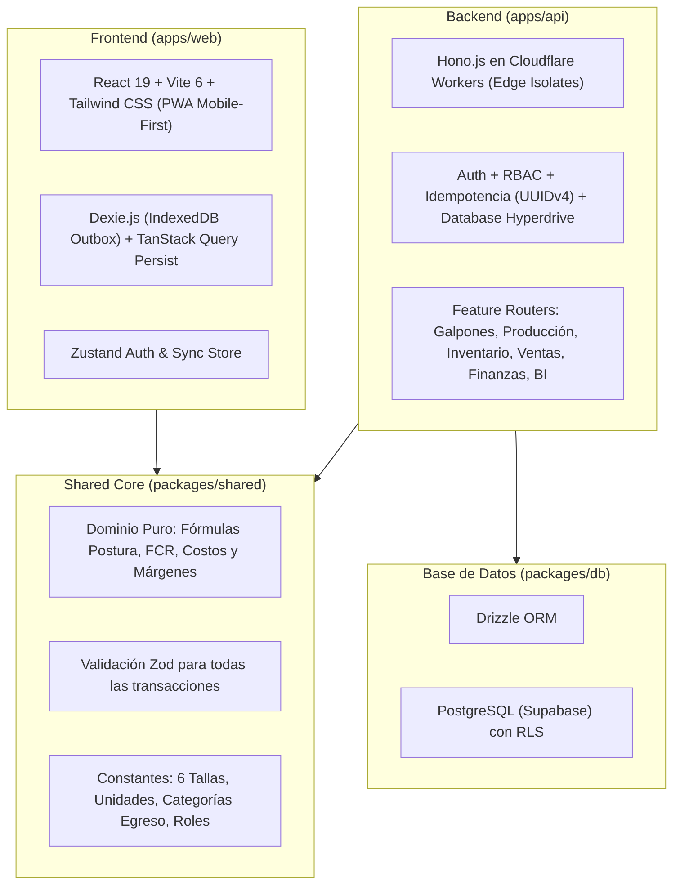
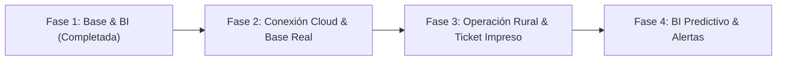

# 📋 Resumen Ejecutivo & Roadmap — ERP Avícola "Alta La Estancia"

> **Proyecto:** Core ERP & Analítica Agroindustrial para Granja Avícola de Postura  
> **Unidad Productiva:** 4,000 gallinas *Hy-Line Brown* (Galpón 1: 1,500 aves | Galpón 2: 2,500 aves)  
> **Unidades Base:** 1 Maple = 30 huevos | 1 Caja Estándar = 12 maples = 360 huevos  
> **Versión Actual:** MVP v1.0 (Foundation & Interactive Prototype)

---

## 🏗️ 1. Arquitectura Técnica Implementada

El sistema está construido sobre un **Monorepo moderno (Turborepo + PNPM)** con arquitectura desacoplada (*Clean Architecture* & *Screaming Architecture*):

---

## ✅ 2. Lo que hace el sistema de momento (Estado Actual)

### 📊 Módulo de Business Intelligence (BI & Analítica)
*Diseñado específicamente para transformar los datos de campo en decisiones de alta rentabilidad.*

- **Detección de Tallas más y menos vendidas:**
  - Identifica la **Talla G (Grande)** como el producto estrella (38% del volumen semanal, 320 maples).
  - Identifica la **Talla M (Mediano)** como segundo producto de alta rotación (210 maples).
  - Alerta sobre la **Talla P (Pequeño)** y **Talla XXG (Doble Extra Grande)** como productos de rotación lenta (>9-14 días en almacén).
- **Motor de Sugerencias Operativas (¿Qué hacer con las que menos se venden?):**
  - **Talla P:** Sugiere empaquetar en cajas estándar de 12 maples para venta mayorista a panaderías a \$2.50/maple (asegurando \$0.65 de ganancia limpia y liberando espacio físico), o activar combos dominicales (1 Maple G + 1 Maple P con descuento).
  - **Talla XXG:** Recomienda reempaque en docenas plásticas gourmet a \$2.50/docena para restaurantes de desayunos (equivale a \$6.25/maple).
- **Matriz de Rentabilidad y Ganancia por Talla:**
  - Cálculo de costo proporcional de alimento para cada una de las 6 tallas comerciales.
  - Cálculo en tiempo real de ganancia neta por maple y porcentaje de margen bruto (33.9% en P hasta 56.5% en XXG).
- **Curva de Postura vs Genética *Hy-Line Brown*:**
  - Comparativa gráfica diaria de Galpón 1 vs Galpón 2 frente al estándar internacional (92.0%).

---

### 🥚 Módulo de Producción y Censo de Galpones
- **Censo Activo:** Control de aves vivas para Galpón 1 (1,500 aves) y Galpón 2 (2,500 aves).
- **Cálculo de Dominio en Tiempo Real:**
  - $\text{\% Postura Diaria} = \left(\frac{\text{Maples}\times 30 + \text{Sueltos}}{\text{Aves Vivas}}\right) \times 100$
  - $\text{FCR (Conversión Alimenticia)} = \frac{\text{Kg Alimento}}{\text{Maples Producidos}}$
- **Registro de Mortalidad:** Descuenta inmediatamente las bajas del censo activo del lote para mantener la exactitud del cálculo de postura.
- **Historial Diario:** Bitácora con semaforización de eficiencia productiva.

---

### 📦 Módulo de Inventario por Tallas
- **Clasificación en 6 Tallas Comerciales Calibradas:**
  - **P:** Pequeño (< 48 g)
  - **CH:** Chico (48 – 52 g)
  - **M:** Mediano (53 – 59 g)
  - **G:** Grande (60 – 66 g)
  - **XG:** Extra Grande (67 – 72 g)
  - **XXG:** Doble Extra Grande (> 72 g)
- **Conversión Bidireccional Inmediata:** Visualización simultánea de stock disponible en **Maples** y **Cajas Estándar** (1 Caja = 12 Maples = 360 unidades).
- **Recepción de Postura:** Ingreso de producción clasificada al almacén.
- **Registro de Mermas / Roturas:** Descuento por huevos cascados en selección para mantener el stock físico cuadrado con el kardex.

---

### 🛒 Módulo de Ventas y Cuentas por Cobrar
- **Notas de Remisión:** Emisión para despachos dominicales fuertes y ventas menores semanales.
- **Condiciones de Pago:**
  - `CONTADO`: Registra automáticamente un ingreso en la caja chica.
  - `CREDITO`: Acumula el saldo deudor al historial del cliente mayorista.
- **Cuentas por Cobrar:** Control de crédito en calle por cliente.
- **Descuento de Stock Transaccional:** Cada remisión descuenta automáticamente los maples vendidos del inventario disponible.

---

### 💰 Módulo de Finanzas y Caja Chica
- **Control de Egresos Categorizados:** Registro de compras operativas (*Alimento Concentrado, Insumos/Vitaminas, Maples Vacíos, Transporte/Flete, Veterinaria, Varios*).
- **Arqueo Semanal Dominical:** Conciliación obligatoria dominical:
  $$\text{Saldo Esperado} = \text{Saldo Inicial} + \text{Ingresos Efectivo} - \text{Egresos}$$
  Permite ingresar el dinero físico en mano para verificar si la caja está cuadrada al centavo.

---

### 🛡️ Seguridad, Roles y Modo Offline
- **RBAC (3 Roles):** Administrador (control total), Encargado de Galpón (postura/censo), Encargado de Almacén (inventario/remisiones).
- **Selector Rápido de Roles:** Botones en pantalla de login para conmutar permisos y probar cada rol sin fricciones.
- **Offline-First:** Almacenamiento local mediante Dexie.js (IndexedDB) con cola de mutaciones pendiente para zonas rurales sin cobertura.

---

## 🚀 3. Lo que se planea implementar (Roadmap de Próximas Fases)

### 🔹 Fase 2: Conexión Cloud & Base de Datos Real
1. **Despliegue de Base de Datos en Supabase:**
   - Aplicar las migraciones Drizzle (`pnpm db:migrate`) en la instancia PostgreSQL remota.
   - Ejecución del script de seed (`packages/db/src/seed.ts`) para poblar los 2 galpones, lotes iniciales y tallas.
2. **Políticas RLS (Row Level Security):**
   - Habilitar aislamiento estricto de tablas mediante `auth.uid()` y verificación de roles a nivel de base de datos.
3. **Despliegue del Backend en Cloudflare Workers:**
   - Configuración de Cloudflare Hyperdrive para conexión acelerada por connection pooling a PostgreSQL.
   - Activación del middleware de idempotencia en tabla (`idempotency_keys`) para evitar duplicidad de remisiones si se corta la red.

---

### 🔹 Fase 3: Operación en Zona Rural & Despacho Dominical
1. **Sincronización en Segundo Plano (Background Sync):**
   - Service Workers de sincronización automática desatendida cuando el galponero vuelva a tener señal 4G/LTE.
2. **Impresión Térmica / Ticket de Remisión:**
   - Generación de tickets en formato térmico Bluetooth (58mm/80mm) y PDF descargable para entregar al chofer o cliente mayorista el domingo.
3. **Precios Semanales de Mercado Dinámicos:**
   - Interfaz rápida para que el Administrador actualice los precios del maple cada viernes o sábado antes del despacho dominical.

---

### 🔹 Fase 4: Analítica Predictiva & Automatizaciones
1. **Proyecciones de Postura y Curva de Vida:**
   - Algoritmo que proyecta la postura esperada para las próximas 12 semanas según la edad actual de las gallinas (Semanas 28 y 34) y alertas de muda o caída productiva.
2. **Costeo ABC (Activity-Based Costing) Integral:**
   - Prorrateo no solo del alimento, sino de energía, amortización de pollitas y mano de obra para calcular el margen neto final de la granja.
3. **Alertas Inteligentes:**
   - Detección de anomalías en consumo de agua/alimento o caídas de postura mayores al 3% diario para alertar sobre posibles riesgos sanitarios o estrés térmico.
4. **Exportación Contable:**
   - Descarga de reportes en Excel (.xlsx) y CSV para el contador o declaración de ingresos/gastos.

---

## 📌 Enlaces Útiles
- **Documento en el repositorio:** `RESUMEN_SISTEMA_Y_ROADMAP.md`
- **Servidor Web Activo:** [http://localhost:5173/](http://localhost:5173/)
